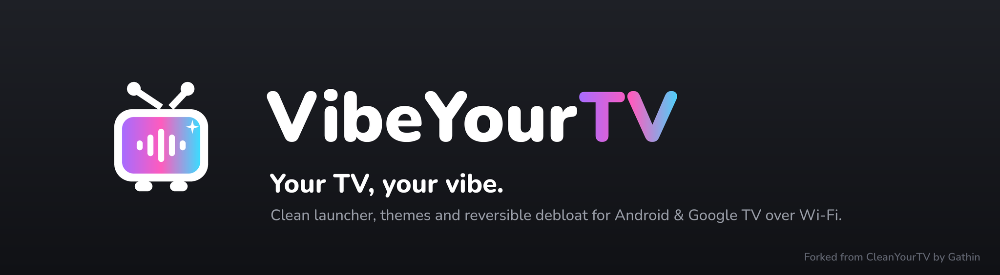
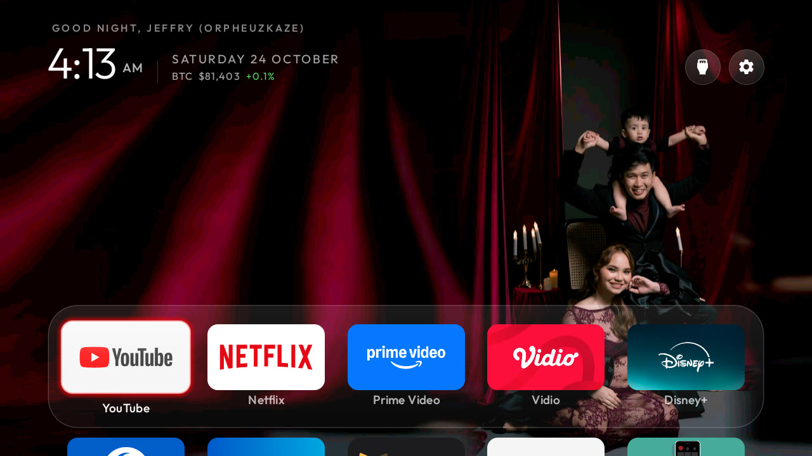
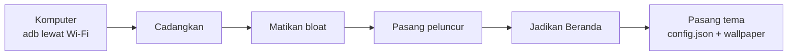

<p align="center">
  
</p>

<p align="center">
  <a href="https://x.ai/bot/7iH14dp1VnBLUbqq2oEne"></a>
</p>

<p align="center">Lewati penyiapan manual. Bot VibeYourTV memandumu langkah demi langkah lewat Wi-Fi dengan adb.</p>

> **VibeYourTV** adalah fork dari [CleanYourTV](https://github.com/Gathin23/cleanyourtv) karya **Gathin** (lisensi MIT, hak cipta Gathin tetap utuh). Diterjemahkan dan dikembangkan oleh Ahmad Jeffry Aryanto ([@orpheuskaze](https://x.com/orpheuskaze)).

<p align="center">
  
</p>

*Sapaan memakai namamu (`greeting_name`). Harga BTC hidup di bawah tanggal (`crypto_ticker`). Dock-nya kaca buram, berisi aplikasi yang kamu pilih. Wallpaper-nya fotomu sendiri.*

## Pasang sebagai Grok Bot

Lewati penyiapan manual. Tambahkan bot VibeYourTV ke Grok Bot-mu, lalu ia memandumu langkah demi langkah lewat Wi-Fi dengan adb: **[Pasang di Grok Bot](https://x.ai/bot/7iH14dp1VnBLUbqq2oEne)**

## Tutorial: Pakai Grok Bot

Grok Bot adalah asisten AI yang bisa menjalankan perintah di komputermu (Windows atau Mac) setelah komputer itu terhubung ke bot. Tidak perlu aplikasi di ponsel. Hasilnya seperti [tangkapan layar di atas](docs/images/vibeyourtv-home.jpg): sapaan dengan namamu, harga BTC di bawah tanggal, dock kaca buram, dan fotomu sebagai wallpaper.

### 1. Di TV

Buka **Settings → System** atau **Device Preferences → About**. Tekan **Build** atau **Android TV OS build** tujuh kali sampai opsi pengembang terbuka. Kembali, masuk **Developer options**, lalu nyalakan **USB debugging** dan, kalau ada, **Network debugging** atau debugging lewat Wi-Fi. Catat IP TV di **Settings → Network**. Biarkan TV menyala.

### 2. Di komputer

Pastikan komputer dan TV ada di Wi-Fi yang sama. Hubungkan komputer itu ke Grok Bot supaya bot bisa menjalankan perintah di sana.

### 3. Tambahkan skill, atau tempel repo

Pasang skill dari [`grok-bot-skill/`](grok-bot-skill/README.md) ke Grok Bot (langkahnya ada di README itu), atau tempel saja tautan repo ini ke obrolan: <https://github.com/ahmadaryanto/vibeyourtv>.

### 4. Contoh yang bisa disalin

Ganti `192.168.x.x` dengan IP TV-mu. Sesuaikan daftar aplikasi dan nama.

```text
Bersihkan TV gua pakai repo ini, IP TV 192.168.x.x, jangan pakai aplikasi HP
Aplikasi yang mau gua simpan: YouTube, Netflix, ...
Install launcher-nya dan jadikan Home
Bebasin storage, hapus aplikasi yang nggak kepake
Pakai foto ini jadi wallpaper, pastikan semua wajah kelihatan
Bikin tombolnya minimalis kayak iPad
Tambah sapaan Good morning/night + nama gua
Tampilkan harga BTC live
```

### 5. Yang akan terjadi

Grok Bot memasang adb (platform-tools) di komputer, lalu menyambung ke TV. Di TV muncul **Allow USB debugging?**: centang **Always allow**, lalu izinkan. Bot mencadangkan daftar aplikasi lebih dulu dan bertanya sebelum menghapus apa pun. Yang dimatikan dengan `pm disable-user` bisa dikembalikan. Yang benar-benar dihapus tidak.

### 6. Kalau macet

| Gejala | Yang dicoba |
|---|---|
| **device offline** | Nyalakan TV (bukan standby yang memutus ADB), pastikan satu Wi-Fi, lalu sambungkan lagi ke `IP:5555`. |
| **Penyimpanan penuh** | Minta bot mengosongkan cache aplikasi yang besar. Hapus aplikasi hanya yang memang tidak terpakai, dan hanya setelah kamu setuju. |
| **Mau kembali seperti semula** | Jalankan `tools/restore.sh` dengan daftar yang tadi diterapkan. Penjelasannya di [Mengembalikan TV kamu](#mengembalikan-tv-kamu). Dari TV, Settings → Apps juga bisa menyalakan lagi paket yang dimatikan. |

<p align="center">
  <a href="https://github.com/Gathin23/cleanyourtv/stargazers"></a>
  <a href="https://github.com/Gathin23/cleanyourtv/pulls?q=is%3Amerged"></a>
  <a href="https://github.com/Gathin23/cleanyourtv/network/members"></a>
  <a href="https://github.com/Gathin23/cleanyourtv/graphs/contributors"></a>
  <a href="README.zh-CN.md"></a>
  <a href="README.vi.md"></a>
  <a href="README.ja.md"></a>
  <a href="https://buymeacoffee.com/gathint"></a>
  <a href="https://www.producthunt.com/products/cleanyourtv"></a>
</p>

<p align="center">
  <a href="https://trendshift.io/repositories/310225"></a>
</p>

<p align="center">
  <a href="docs/PRESS.md"></a>
</p>

**Cuitan yang viral:** [x.com/gathint/status/2111379569030939102](https://x.com/gathint/status/2111379569030939102)

Pada 17 Oktober 2026 Gathin mengunggah foto sebelum dan sesudah TV orang tuanya, yang dibersihkan
Claude Code lewat Wi-Fi. Unggahan itu mencapai 7,4 juta tayangan, orang-orang mulai melakukan hal
yang sama ke TV mereka, dan balasannya jadi daftar di sini: 170+ model TV dari 200+ kontributor
dalam empat hari. Repo aslinya sempat bernama tv-vibehack sampai tanggal 19; tautan lama tetap jalan.
VibeYourTV adalah fork dari proyek itu.

**Tema, sakelar, dan add-on:** [cleanyour.tv/addons](https://cleanyour.tv/addons)

**Tautan resmi CleanYourTV:** situsnya [cleanyour.tv](https://cleanyour.tv). Kode, peluncur, dan
alat aslinya ada di repo [Gathin](https://github.com/Gathin23/cleanyourtv). VibeYourTV mengembangkan
fork itu. Domain lain yang memakai nama tersebut, misalnya cleanyourtv.com, bukan dijalankan proyek
ini ([#1004](https://github.com/Gathin23/cleanyourtv/issues/1004)).

## Sesuaikan sendiri

Layar beranda ini bisa kamu ubah tanpa menyentuh kode. Contoh di Sharp AQUOS Google TV ada di [tangkapan layar di atas](docs/images/vibeyourtv-home.jpg).

- **Ganti tema.** Pilih tampilan di `themes/` lalu pasang dengan `tools/theme.sh`. Warna, dock, dan jumlah kolom ikut tema. Contohnya di bawah.
- **Pakai fotomu sebagai wallpaper.** Simpan gambar 16:9 (1920×1080 sudah pas) sebagai `wallpaper.jpg` di folder tema. Kalau ada wajah, taruh di sepertiga tengah dan sisakan ruang di tepi. TV memotong pinggir, jadi jangan tempel wajah di ujung kiri atau kanan.
- **Sapa dengan namamu.** Di `config.json` isi `"greeting_name": "Nama Kamu"`. Sapaan waktu (pagi, siang, sore, malam) akan diikuti nama itu.
- **Harga Bitcoin langsung.** Isi `"crypto_ticker": true` supaya baris harga BTC muncul di bawah tanggal. Harganya diambil dari CoinGecko dan disegarkan tiap 5 menit selama Beranda sedang terbuka. Mati secara bawaan.

| | | | |
|---|---|---|---|
|  |  |  |  |
| *Bawaan* | *Aurora* | *Kaca* | *Enam kolom* |
|  |  |  |  |
| *Adegan, berganti tiap jam* | *Ruska* | *Swedia* | *Dussehra* |

<a id="how-it-works"></a>

## Cara kerjanya

Dari komputer, lewat adb di Wi-Fi yang sama, urutannya begini:



Android TV punya jembatan debug yang sama dengan ponsel Android. Nyalakan USB debugging di opsi
pengembang TV, izinkan komputermu sekali, dan sisanya perkakas Android biasa:

| Langkah | Yang terjadi |
|---|---|
| **Cadangkan** | Daftar paket yang terpasang dan pengaturannya. |
| **Matikan** | Telemetri pabrikan, layanan iklan, baris konten, dan aplikasi bawaan yang tidak kamu minta, dengan `pm disable-user`. Tidak ada yang dicopot, jadi skrip restore bisa mengembalikan setiap langkah. |
| **Pasang** | Peluncur kecil bawaan, dijadikan layar beranda. |

**Tanpa root, tanpa kabel, tidak ada yang dicopot, dan satu baris perintah untuk mengembalikan semuanya kalau kamu berubah pikiran.**

Bloatware beda-beda tiap merek, jadi prompt-nya menyuruh asisten kodingmu menemukan sendiri di TV
kamu dan bertanya dulu sebelum menyentuh apa pun yang mungkin masih kamu pakai.

<a id="quick-start"></a>

## Mulai cepat

| Yang kamu punya | Lakukan ini |
|---|---|
| **Komputer** | Pakai prompt bersama asisten koding: tiga langkah di bawah. |
| **Hanya ponsel Android** | Pakai [aplikasi Clean Your TV](https://cleanyour.tv/app) buatan komunitas oleh [@udhaykumarbala](https://github.com/udhaykumarbala): sambungkan, analisis, bersihkan, sekitar lima menit. Tanpa laptop, tanpa agen koding. |

Dengan komputer, komputer itu harus satu Wi-Fi dengan TV, dan asisten kodingnya harus bisa menjalankan shell.

Yang ini semuanya bisa: Claude Code (di [0G Private Computer](https://pc.0g.ai) atau [paket Anthropic](https://claude.com/pricing)), [Codex](https://github.com/openai/codex), atau [Gemini CLI](https://github.com/google-gemini/gemini-cli).

| Di mana | Yang dilakukan |
|---|---|
| **1. Di TV** | Settings → Device Preferences → About → tekan OK pada **Build** tujuh kali → kembali → Developer options → **USB debugging** nyala. Kalau ada sakelar Network atau ADB debugging, nyalakan juga. Biarkan TV menyala. |
| **2. Di komputer** | Tempel [`PROMPT.md`](PROMPT.md) ke asistenmu dan isi model TV-mu. |
| **3. Ikuti terus** | Terima "Allow USB debugging?" di TV, lalu jawab daftar centang: aplikasi mana yang kamu pakai, ukuran dock dan urutan aplikasi, apakah asisten suara, Chromecast, dan pembaruan tetap dibiarkan. |

Asisten mencadangkan, membersihkan bloatware, membangun dan memasang peluncur, lalu memeriksa tiap
langkah dengan tangkapan layar yang diambil dari TV. Dengan repo ini sebagai konteks, prosesnya
sekitar lima belas menit.

## Yang kamu dapat

Layar beranda yang mirip Apple TV dan tidak menghalangi:

| Bagian | Tampilannya |
|---|---|
| **Beranda sehitam malam** | Dock berisi empat aplikasi favoritmu di pita bersudut membulat, di tempat Apple TV meletakkannya. |
| **Rak atas** | Menyebut aplikasi yang sedang dipilih dengan huruf besar, plus cahaya lembut berwarna dari gambar aplikasinya. |
| **Aplikasi lain dalam kisi** | Naik ke atas saat kamu menekan Bawah. |
| **Satu sorotan kaca yang melayang** | Melenting dari ubin ke ubin. Ubin yang dipilih terangkat dan menampilkan namanya. |
| **Tiga tombol kaca buram** | Input (port HDMI dengan nama yang kamu beri di pengaturan TV, AV, Live TV), Wi-Fi atau Ethernet beserta nama jaringannya, Settings. |
| **Sapaan, jam tipis, dan tanggal** | Dalam huruf [Outfit](https://fonts.google.com/specimen/Outfit), plus screensaver Clock yang senada. Isi `show_stats` di config atau tema untuk satu baris di bawah jam: CPU, memori bebas, dan penyimpanan bebas. Baris itu mati sampai kamu menyalakannya, dan hanya disegarkan selagi Beranda ada di layar. |
| **Tema dan kartu modul** | Tema mengubah warna, wallpaper, dock, dan kolom tanpa build ulang, dan kartu modul mengizinkan aplikasi lain menancapkan ubin, hanya kalau kamu setuju. |

Dan TV yang berhenti melawanmu: tidak ada baris bersponsor, tidak ada desakan "Discover", tidak ada
analitik yang menelepon ke rumah, tidak ada aplikasi yang tidak kamu minta.

| | |
|---|---|
|  |  |
| *Rak atas dan cahaya lembut* | *Input: HDMI beserta status sambungan, AV, Live TV* |
|  |  |
| *Kisi, satu sorotan kaca, nama ubin* | *Screensaver Clock, bergeser supaya tidak membakar layar* |
|  |  |
| *Tema Aurora, dipasang dengan `tools/theme.sh`* | *Enam kolom dan dock enam aplikasi, peluncur yang sama* |
|  |  |
| *Dengan `tile_menu`, tahan OK pada ubin, Move: panah membawanya, Back meletakkannya* | *Pustaka aplikasi: satu tekan mengembalikan aplikasi yang dilepas ke Beranda* |

## TV yang didukung

Apa pun yang menjalankan **Android TV** atau **Google TV**.

| Platform | Yang jalan |
|---|---|
| **Android TV, Google TV** | Debloat dan peluncurnya. |
| **Fire TV** | Hanya separuh debloat, karena Fire OS tidak mau menyerahkan Home ke peluncur pihak ketiga. And on the 2015 Fire TV Box (Fire OS 5) even that half fails: every `pm` route is refused. Di kotak itu setiap jalur `pm` ditolak. |
| **Beberapa TCL pasar Tiongkok** | Mereka menolak memasang peluncur apa pun; daftarnya mengatakan itu di kepala berkas. |
| **Samsung (Tizen), LG (webOS)** | Sistem yang berbeda. Lihat [SHOWCASE.md](SHOWCASE.md#other-platforms-fire-tv-and-lg-webos) untuk tiga port webOS, dan [docs/devices/samsung-tizen.md](docs/devices/samsung-tizen.md) untuk apa yang dijawab sebuah Samsung 2021 lewat Wi-Fi (tidak ada ADB, jadi tidak ada `pm disable-user`) kalau kamu sedang menimbang port Tizen. |

Daftar yang sudah dicoba kontributor, satu folder per model di [`examples/`](examples/):

**TCL** 57 · **Sony** 31 · **Xiaomi** 28 · **Philips** 12 · **Hisense** 9 · **Skyworth** 9 · **Amazon Fire TV** 7 ·
**Thomson** 4 · **BenQ** 3 · **Google** 3 · **OnePlus** 3 · **Panasonic** 3 · **CHiQ** 2 · **FFalcon** 2 · **Haier** 2 ·
**Hitachi** 2 · **Kalley** 2 · **Motorola** 2 · **Nokia** 2 · **NVIDIA Shield** 2 · **onn** 2 · **Redmi** 2 ·
**SHARP** 2 · **Toshiba** 2 · **Vu** 2 ·
AiPro2K · AIWA · Artel · Caxium · Cecotec · Challenger · Compac · Dialog · EKO · Freebox · Grundig · Insignia Fire TV ·
JVC · Karbonn · Kogan · Lumio · MTC · Noblex · OK. · PEAQ · Polytron · PRISM+ · RCA · RockTek · Sankey · SANYO · Sber ·
Super General · Tele System · TiVo · Tornado · Turkcell · Verizon · Vidda · Vision ·
proyektor Anker Nebula, BYINTEK, Epson, Formovie, Gadnic, JMGO, Magcubic, Portronics, Stellamore, Wanbo, dan XGIMI

<details>
<summary><strong>Daftar lengkap</strong></summary>

| TV | OS |
|---|---|
| AiPro2K (Expressluck, dongnae; Changhong AI PONT family) | Android TV 14 |
| AIWA AI PONT SA (Changhong, osaka, ISDB86AW) | Google TV 14 |
| Amazon Fire TV, AFTDEC012E (ginza), Android 11 | Fire OS / Android 11 |
| Amazon Fire TV smart TV (AFTEU014, greta, MediaTek m7322), Germany | Fire OS 7.6.8.5 / Android 9 |
| Amazon Fire TV 50" 4K smart TV (AFTTIFF43, brandenburg) | Fire OS 7.7.1.7 / Android 9 |
| Amazon Fire TV Stick 4K Max, 1st gen 2021 (AFTKA, kara), Colombia | Fire OS 7.7.1.3 / Android 9 |
| Amazon Fire TV Stick 4K, 1st gen 2018 (AFTMM, mantis) | Fire OS 6.7.1.1 / Android 7.1 |
| Amazon Fire TV Stick 4K, 2nd gen 2023 (AFTKM, karat), Brazil | Fire OS 8.1.8.5 / Android 11 |
| Amazon Fire TV Stick Lite, 1st gen 2020 (AFTSS, sheldon) | Fire OS 7.7.1.7 / Android 9 |
| Anker Nebula Cosmos projector D2140 (D2140-Cosmos, SDMC/Amlogic, 2 GB), Vietnam | Android TV 9 |
| Anker Nebula projector D2426 (D2426_CapsuleIIIPro, baekdu, SDMC/MediaTek m7632, 1.7 GB), Brazil | Android TV 14 |
| Artel smart TV (CVTE TP.MT5510S.PB782, cvt_mt5863_eu, SMART_TV), Uzbekistan | Android 7.0 |
| BenQ E55-735 (Changhong AI PONT, DVB96BQ) | Google TV 14 |
| BenQ E55-750 (Changhong AI PONT, DVB96BQ) | Google TV (Android 11) |
| BenQ GV32 portable projector (SDMC, BenQ_GV01, himalaya, MediaTek m7332) | Google TV 14 |
| BYINTEK Love U4 projector, 1080P (Skyworth RG_HS352, HiSilicon Hi3751V350, 1 GB), Brazil | Android 9 |
| BYINTEK T5 Max projector (built-in Google TV stick: SkyworthDigital YYT, Amlogic), Brazil | Google TV 14 |
| Caxium 58" 147 cm UHD Smart TV (Realtek RTD285O, RTK2851P, TopTech + Zeasn), Colombia | Android TV 9 |
| Cecotec VQU10065S 65" QLED (Vestel-built, shandao, MediaTek), Spain | Android TV 14 |
| Challenger 32T22 BT (cvt_mt5863_col, board TP.MT5510.PB781, MediaTek MT5659, 1 GB RAM), Colombia | Android 7.0 |
| CHiQ AI PONT (Changhong GTVU65, dangni, MediaTek mt5867) | Google TV 14 |
| CHiQ AI PONT (DVB93CQ) | Android TV 11 |
| Chromecast with Google TV 4K (sabrina) | Google TV 14 |
| Chromecast with Google TV HD (boreal) | Google TV 14 |
| Compac ATV R2 (SCBC R2, Realtek RTD285O) | Android TV 9 |
| Dialog ViU (SEI Robotics SEI103DL, Amlogic, NES middleware), Sri Lanka | Android TV 9 |
| EKO 2K Google TV (MTC-built, tennoji, MediaTek mt5867 / T56) | Google TV 14 |
| Epson LS800 laser projector (Askey HA90 module, sti6202d101, Amlogic) | Android TV 14 |
| FFalcon (雷鸟) 鹤6 PRO 65S585C Pro (China, tcl_mt5879_cn, MediaTek MT9653) | Android TV 11 |
| FFalcon (雷鸟) r34a0, China (V8-A920T01-LF1V147, Amlogic T920), 1 GB | Android 5.1.1 |
| Formovie Laser 4K projector (hanlla, MediaTek T31 / m7632, 1.8 GB) | Android TV 14 |
| Freebox Player POP (Free, fbx8am, Amlogic), IPTV/DVB-T box | Android TV 10 |
| Formovie / Fengmi projector MiProjM05 (eva, Amlogic) | Android TV 9 |
| Gadnic PROJ100W projector (built-in Google TV stick: SkyworthDigital YYT, Amlogic HP46B), Argentina | Google TV 14 |
| Google TV Streamer 4K (kirkwood, GZRNL) | Google TV 14 |
| Grundig Android UHD TV (Arçelik, GxGrNM, kunyang, MediaTek), Turkey | Android TV 14 |
| Haier Android TV DVB2K (broadway, HaierATVT56DVB) | Android TV 11 |
| Haier H32S80EFX (MatrixTV CE, HRT56EU, deto, MediaTek), Thailand | Google TV 14 |
| Hisense 65D62QH (VIDAA_TV, MediaTek MT9653), China | Android TV 11 |
| Hisense E5Q Pro (VIDAA_TV, MediaTek MT9653), China | Android TV 11 |
| Hisense Fire TV (AFTCIBFBD1, coyote, MediaTek), US | Fire OS 8.0 / Android 11 |
| Hisense HG9 (HiSmart 4K A4FFM) | Android TV 9 |
| Hisense HiSmartTV A4 (xiaoyushan, MStar m7322), Android 11 firmware RTT2.221108.001 | Android TV 11 |
| Hisense HiSmartTV A4 (xiaoyushan, MStar m7322), India | Android TV 9 |
| Hisense SmartTV 4K FFM (songshan, MediaTek m7632) | Android 11 (SDK 30) |
| Hisense SmartTV 4K FFM (huangshan, MediaTek), Latin America; also the US Hisense U9DG | Android TV 10 |
| Hisense SmartTV 4K FFM (lushan, MediaTek MT9676), Mongolia | Google TV 12 |
| Hisense U75 (hengshan, MediaTek), Latin America | Google TV 12 |
| Hitachi 65QLEDSM20 (MTC, bangbae, MediaTek m7322), Australia | Android TV 11 |
| Hitachi CDH-LE32SMART21 (TCL-built C06, C06_2K_GB, MediaTek MT9221, 1 GB), Argentina | Android TV 11 |
| INCLO Google TV 4K (KTC, Realtek, khardi, KTC_INCLO_4K_EU_23GV1), Taiwan | Google TV 11 |
| Insignia 55" F30 4K Fire TV (NS-55F301NA25, AFTDCT31, duckie) | Fire OS 7 / Android 9 |
| JMGO N1S projector (K80A, holan, MediaTek m7332), Australia | Google TV 14 |
| JVC Android TV (Vestel-built, BARTU_Jvc, menlo, MediaTek mt5867), Spain | Android TV 11 |
| Kalley 43G200 (device R3_GTV, MOKA, Realtek RTD2841A), Latin America | Google TV 14 |
| Kalley R10G (device R10G, product ACER_FFM, MOKA, Realtek RTD2875P), Latin America | Google TV 14 |
| Karbonn SWTV-20AE (Skyworth OEM, SW4H, MediaTek), India | Android TV 10 |
| Kogan Google TV (Changhong CHiQ AI PONT, GTVU65KG, dangni, MediaTek mt5867), Australia | Google TV 14 |
| KTC 4K Smart TV (device hongkong, MediaTek), Taiwan | Google TV 14 |
| Liberton LTV 24H01AT (Liberton, built by Changhong, device redwood), Ukraine | Android TV 11 |
| Lumio Vision 7 55" (KTC ODM, Realtek, khardi, KTC_LUMIO_4K_EU_23GV1), India | Google TV 14 |
| Magcubic HY300 Pro projector (rk3566_rgo, device adt3, Askey) | Android 11 |
| Motorola MT4310 (Newsan; Hisense board, hayward, MediaTek), Argentina | Android TV 11 |
| Motorola SWTV-24AE-FHD (Skyworth OEM, beomil, MediaTek), India/Global | Google TV 14 |
| MTC UK 2K Android TV (tabata, MediaTek m5621; JVC-family firmware, `android.autoinstalls.config.JVC` present), UK | Android TV 11 |
| Noblex NoblexTV (Skyworth-built, shinjuku, MediaTek m5621), Argentina | Android TV 11 |
| Nokia Streaming Box 8000 (Sagemcom/NES, SEI600NK4, HND, Amlogic) | Android TV 14 |
| Nokia Streaming Box 8010 (Sagemcom/NES, SEI804NK, YYJ, Amlogic) | Android TV 14 |
| NVIDIA SHIELD TV 2019 tube (P3430, sif) | Android TV 11 |
| NVIDIA SHIELD TV Pro 2019 (P2897, mdarcy) | Android TV 11 |
| OK. AI PONT (Changhong, ikebukuro, MediaTek), Italy | Android TV 11 |
| OnePlus TV (C00, Cebu, MediaTek m7632), India | Android TV 10 |
| OnePlus TV (D00, Dubai) | Google TV 14 |
| OnePlus Y1 43" (Y Series, shibuya) | Android TV 11 |
| onn 4K Streaming Box (2023, Walmart; YOC, Amlogic), US | Google TV 14 |
| onn. 4K Plus Streaming (2025, Walmart; coffey, Amlogic S905X5M), US | Google TV 14 |
| Panasonic 4KTV-0SU (Skyworth-built SW4H, MediaTek m7332), Gulf region | Android TV 10 |
| Panasonic 4KTV-JUP (Jupiter_PA, MediaTek) | Android TV 11 |
| Panasonic TH-40HS550K (Skyworth-built, GS655 shibuya, MediaTek) | Android TV 11 |
| Philips 50PUD7406/43 (TPV, PH0M_EA_T32, MStar/MediaTek), Chile | Android TV 11 |
| PEAQ PTV 43AQU-5023C (Changhong, reports OK. AI PONT, dundas, MediaTek m7332) | Android TV 11 |
| Philips 50PUS8517/12 (TP Vision, PH1M_EA_9970A, MediaTek MT5895), Europe | Android TV 11 |
| Philips 55OLED707/12 (TP Vision, PH1M_EA_9970A, MediaTek MT5895), UK | Android TV 11 |
| Philips 55OLED708/12 (TPV, PH1M_WW_9972, MediaTek), Poland | Google TV 12 |
| Philips 55PUS7503/12 (TP Vision TPM171E, PH7M_EU_5596, MediaTek MT5891), Europe | Android TV 8.0 |
| Philips 65PUS8102/12 (TP Vision TPM171E, PH7M_EU_5596, MediaTek MT5891), Europe | Android TV 8.0 |
| Philips 65PUS9435/12 (TP Vision TPM191E, PH9M_EA_5599, MediaTek MT5887), Germany | Android TV 12 |
| Philips 75PUS8505/12 (TP Vision TPM191E, PH9M_EA_5599, MediaTek MT5887), Europe | Android TV 12 |
| Philips Google TV TA7 (TPV, PH3M_AL_T32, MediaTek), Brazil | Google TV 14 |
| Philips R8G Google TV (MOKA, whitefield, Realtek RTD2851F), US | Google TV 14 |
| Philips Smart 4K TV (Skyworth, eleonas, MediaTek), India | Google TV 14 |
| Philips TPM191E (TP Vision, PH9M_EA_5599, MediaTek mt5887), Europe | Android TV 12 |
| Polytron 2K (WLTV POLYTRON2K, hayward; Hisense/CVTE board, MediaTek mt5867), Indonesia | Android TV 11 |
| Portronics Beem 470 Smart LED Projector (Allwinner H713, 1 GB), India | Android 11 |
| PRISM+ Q65 Ultra 2026 QLED 4K AI Google TV (R10G, PRISMPLUS_FFM, MOKA, Realtek RTD2875 SoC, RTD6748 platform) | Google TV 14 |
| RCA AI PONT SA (Changhong, redwood, ISDB92RC; also sold as realme 40-inch and AIWA AW32B4SMG) | Android 14 |
| Redmi TV (MiTV-ANTL0, starwars) | Android 5.1.1 (not Android TV) |
| Redmi TV (MiTV-MFTP0, alita), China firmware 23.2.10.6129 | Android TV 9 (CN build) |
| RockTek GB1 | Google TV 14 |
| SANYO ATV R2 (SCBC, Realtek RTD285O) | Android TV 9 |
| Sankey SMART2KTVSE (Whale OS, SiliconPlayer am30bm) | Android TV 13 |
| Sber Salute TV 43" (CVTE TP.T962D4.PC756, Amlogic T962D4, at30a6, 2 GB), Russia | StarOS 1.101 / Android 13 |
| SHARP 2T-C32GH3000I (SHARP 2K Smart TV-A; Skyworth-built, beomil, MediaTek mt5867), Indonesia | Google TV 14 |
| SHARP AQUOS TVE21F (AQUOS-TVE21F, banqiao, CVTE/MediaTek), UK | Android TV 14 |
| Skyworth / Coocaa 8R40_K5C (Realtek rtd285x, 1 GB, 32-bit), China domestic firmware | Android 8.0 (not Google TV) |
| Skyworth 65A3F (7T641_A3F, MediaTek MT9633), China | Android 13 (CCOS 10.01.250328) |
| Skyworth Coocaa K3 Pro 90P3D Max (8R145_P3DM, Realtek RTD2885N), China market | Android 11 (Coocaa OS) |
| Skyworth 7S60_A5 (sky8S34, 1.9 GB), China market | Coocaa OS / Android 8 |
| Skyworth SW-22SA (SW6H, MediaTek), ~1.9 GB | Android TV 14 (Google TV home) |
| Skyworth SWTV-21AE (sunnyvale, MediaTek) | Android TV 14 |
| Skyworth SWTV-22AE-FHD (umeda, MediaTek), Vietnam/Global | Google TV 14 |
| Skyworth SWTV-24AE-4K NF (eleonas, MediaTek mt5896), South Africa/Global | Google TV 14 |
| Skyworth SWTV-24NA-4K NF (eleonas, MediaTek mt5896), US | Google TV 14 |
| Sony BRAVIA 4K AE1 (BRAVIA_AE_M6L, MediaTek MT5897), EU | Google TV 12 |
| Sony BRAVIA 4K AE2 (BRAVIA_AE2, MediaTek MT5897), North America | Google TV 14 |
| Sony BRAVIA 4K GB (BRAVIA_ATV2_EU, BRAVIA_ATV2) | Android TV 9 |
| Sony BRAVIA 4K GB (BRAVIA_ATV2_UC, MediaTek mt5891) | Android TV 9 |
| Sony BRAVIA 4K UR2 (BRAVIA_UR2_4K, MediaTek) | Android TV 10 |
| Sony BRAVIA 4K VH1 (KD-55XH9096, BRAVIA_VH1, MediaTek MT5895), EU | Google TV 12 |
| Sony BRAVIA 4K UR3 (BRAVIA_UR3, MediaTek mt5893), EU | Android TV 10 |
| Sony BRAVIA 4K VH2 (KD-55X80J, BRAVIA_VH2, MediaTek), EU and North America | Google TV 12 |
| Sony BRAVIA 4K VH21 (KD-65X85K, 2022, BRAVIA_VH21, MediaTek MT5895), Australia | Google TV 12 |
| Sony BRAVIA 4K VH21 (XR-55A80K, 2022, BRAVIA_VH21, MediaTek mt5895), EU | Google TV 12 |
| Sony BRAVIA 9 II (K-65XR90M2, BRAVIA_AE3, MediaTek MT5838) | Google TV 14 |
| Sony BRAVIA BF1 (BRAVIA 2 II class, BRAVIA_BF1_4K_A, MediaTek) | Google TV 12 |
| Sony BRAVIA KD-49X8307C (2015, "BRAVIA 4K 2015", SVP-DTV15, MediaTek), EU firmware | Android TV 7.0 |
| Sony BRAVIA KD-55X8000C (2015, "BRAVIA 4K 2015", SVP-DTV15, MediaTek), China firmware | Android TV 7.0 |
| Sony BRAVIA KD-55X8509C (2015, "BRAVIA 4K 2015", SVP-DTV15, MediaTek), EU firmware | Android TV 7.0 |
| Sony BRAVIA KD-55X85J (2021, BRAVIA_VH2, MediaTek MT5895), South America | Google TV 12 |
| Sony BRAVIA KD-55XF8096 (2018, "BRAVIA 4K GB ATV3", BRAVIA_ATV3_4K_EU, MediaTek MT5891), Spain | Android TV 9 |
| Sony BRAVIA KD-55XE8596 (2017, "BRAVIA 4K GB", BRAVIA_ATV2_EU, MediaTek MT5891), UK | Android TV 9 |
| Sony BRAVIA KD-55XF7596 (2018, "BRAVIA 4K GB ATV3", BRAVIA_ATV3_4K_EU, MediaTek MT5891), EU | Android TV 9 |
| Sony BRAVIA KD-65X80J (2021, BRAVIA_VH2, MediaTek), India | Google TV 10 |
| Sony BRAVIA KD-43X80L (2023, BRAVIA_VH22, MediaTek MT5895), EU | Google TV 12 |
| Sony BRAVIA KD-65X82L (2023, BRAVIA_VH22, MediaTek), India | Google TV 12 |
| Sony BRAVIA KD-65X9300D (2016, SVP-DTV15, MediaTek), Asia-Pacific | Android TV 8.0 |
| Sony BRAVIA TL2 (OD0M_EA_T32, TPV-built, MediaTek), Europe | Android TV 11 |
| Sony BRAVIA VU31 4K (BRAVIA_VU31_4K, Realtek), India | Google TV 14 |
| Sony BRAVIA X9000H (2020, BRAVIA_VH1_CN, MediaTek MT5895), China | Android TV 12 |
| Sony BRAVIA XBR-55X850D (Android model "BRAVIA 4K 2015"), firmware 6.827 | Android TV 8.0.0 |
| Sony BRAVIA XBR-55X850C (2015, "BRAVIA 4K 2015", SVP-DTV15, MediaTek), US firmware | Android TV 8.0 |
| Sony BRAVIA XBR-65X900E (2017, BRAVIA_ATV2) | Android TV 9 |
| Sony BRAVIA XBR-65X900F (2018, BRAVIA_ATV3_4K, MediaTek MT5891), US/Canada | Android TV 9 |
| Sony XR-65A80J (65-inch OLED, 2021, BRAVIA_VH2), EU | Google TV 12 |
| Sony XR-65X90J (2021, BRAVIA_VH2, MediaTek MT5895), China | Android TV 10 |
| Stellamore T950S projector (Droidlogic be30a3, Amlogic txhd2) | Android 13 |
| Super General 55" 4K (CVTE TP.SK708D.PC821, Amlogic T972, x30a4, 1 GB), Saudi Arabia | Android 9 |
| TCL / FFalcon China (tcl9655_cn, MediaTek MT9655 "merak", UTT2.250416.001 AU01) | Android 14 |
| TCL 32L5A (C06, model "Smart TV", 1 GB) | Android TV 11 |
| TCL 32S5400A (C06, C06_2K_GB, MediaTek MT9221, 1 GB), 2023 | Android TV 11 |
| TCL 32S5K (C06, C06_2K_GB, MediaTek MT9221, 918 MB), EU | Android TV 11 |
| TCL 40S5400A (C06, C06_2K_GB, MediaTek MT9221, 1 GB) | Android TV 11 |
| TCL 43P615 (Europe, BeyondTV, Realtek RTD2851, AR06) | Android TV 11 |
| TCL 43S450F-CA (S4 Fire TV Edition, AFTDEC012E, ginza, MediaTek), Canada | Fire OS 8.1.8.5 / Android 11 |
| TCL 43S5400A (C06, C06_2K_GB, MediaTek MT9221, 1 GB) | Android TV 11 |
| TCL 43C645 (Smart TV Pro, Realtek RTD2851 / R51MT05, V8-R51MT05-LF1V652); also TCL 60C635 (G03_4K_GB, Realtek rtd288o), Spain | Google TV launcher on Android TV 11 |
| TCL 43EP660 (Europe, BeyondTV, Realtek rtd285o, V8-R851T02-LF1V378) | Android TV 9 |
| TCL 43S5K (G13, G13_2K_GB, MediaTek MT9221, 1 GB), India | Google TV 14 |
| TCL 50C725K (Smart TV Pro, BeyondTV4/BeyondTV6, RTD2851M, Realtek rtd288o, 2 GB), AR10 build | Android TV 11 |
| TCL 50P735 (BeyondTV4, Smart TV Pro) | Google TV 11 |
| TCL 50DP660 (Europe, "Percee TV", MediaTek MT5658 / board mt5891, V8-T658T01-LF1V602) | Android TV 8.0 |
| TCL 50EP680 (Europe, BeyondTV, Realtek rtd285o) | Android TV 11 |
| TCL 50P615 (Greece, BeyondTV, Realtek RTD2851 / rtd285o, AR05) | Android TV 11 |
| TCL 55" 4K Google TV, 2023 (G10, G10_4K_US_NF); also TCL 55P6K, Spain and TCL 43P69K, Netherlands (G10_4K_GB_NF_32BIT) | Google TV 12 |
| TCL 55C715 QLED (Europe, BeyondTV2, Realtek RTD2851, V8-R851T02-LF1V606) | Android TV 9 |
| TCL 55C725 (Smart TV Pro, BeyondTV4, G03_4K_GB, Realtek R51MT05, V8-R51MT05-LF1V620), Italy; also TCL 65C655 Pro (same build) | Google TV launcher on Android TV 11 |
| TCL 55C745, 2023 (G08, G08_4K_GB, MediaTek tcl9618) | Google TV 14 |
| TCL 55C815 (2020, Europe/Denmark, BeyondTV2, Realtek rtd285o) | Android TV 11 |
| TCL 55EP640 (Greece, BeyondTV, Realtek RTD2851 / rtd285o, AR04) | Android TV 11 |
| TCL 55P638 (Smart TV, BeyondTV4) | Android TV 11 |
| TCL 55P7K, Middle East (G10, G10_4K_GB, Realtek RTD2875P) | Google TV 12 |
| TCL 55P8LS QD-Mini LED, Vietnam (G10, G10_4K_GB_32BIT, Realtek rtd6748) | Google TV 12 |
| TCL 55Q10G Pro (China, tcl_mt5879_cn, MediaTek MT9952) | Android TV 11 |
| TCL 55S470G (G10, G10_4K_US_NF, Realtek), US | Google TV 12 |
| TCL 55S546 (5-Series, G03_4K_US, BeyondTV4, GTV93), US | Google TV 11 |
| TCL 58S571F (TCL Fire TV, AFTDEC012E, ginza, MediaTek mt5896), US | Fire OS 8 / Android 11 |
| TCL 65C725 (Smart TV Pro, BeyondTV4) | Android TV 11 |
| TCL 65C735 (Smart TV Pro, G05, MediaTek), France; also TCL 55C728, Turkey, and TCL 65C935, France | Google TV 11 |
| TCL 65C7L (Smart TV Pro, G08, G08_4K_GB, MediaTek tcl9618), 2025, Australia | Google TV 14 |
| TCL 65C7K (Smart TV Pro, G08, G08_4K_GB, MediaTek mt5896), Brazil | Google TV 14 |
| TCL 65Q550G (TCL Smart TV, Google TV 11, V8-R51MT08-LF1V095.021344) | Google TV |
| TCL 65Q650G (US Q6 2023, BeyondTV4, Realtek RTD2851 / R51MT08, V8-R51MT08-LF1V095, 2 GB) | Google TV 11 |
| TCL 85RM7L (G08, G08_4K_GB, MediaTek tcl9618) | Google TV 14 |
| TCL 75T7 (Smart TV Pro, G08, G08_4K_US, MediaTek tcl9618), US firmware | Google TV 14 |
| TCL Q7C (Smart TV Pro, G08, G08_4K_GB, MediaTek tcl9618), European firmware | Google TV 14 |
| TCL ak30a5 (China, Amlogic) | Android TV 9 |
| TCL BeyondTV (India) | Android TV 9 |
| TCL BeyondTV, Poland (Realtek RTD2851, AP03, 2 GB) | Android TV 9 |
| TCL BeyondTV, EU/Nordic (Realtek RTD2851, V8-R851T02-LF1V606) | Android TV 9 |
| TCL BeyondTV2 (Latin America / Brazil, Realtek RTD2851) | Android TV 9 |
| TCL BeyondTV2, Android 11 build (AR05, Realtek rtd285o) | Android TV 11 |
| TCL C755 QD-Mini LED, 2024, Australia (G08, MediaTek tcl9618) | Google TV 14 |
| TCL 55C7K QD-Mini LED, 2025, UK (G08, MediaTek tcl9618) | Google TV 14 |
| TCL C89B 85", 2024, a local variant of the C855 (G08, G08_4K_GB, MediaTek tcl9618) | Google TV 14 |
| TCL 75C845X2, UK/Europe (G08_4K_GB, MediaTek tcl9618) | Google TV 14 |
| TCL L40S66E (C06, C06_2K_GB, MediaTek MT9221, 1 GB), Argentina | Android TV 11 |
| TCL QM6K Pro, 2025 (G08, MediaTek tcl9618) | Google TV 14 |
| TCL Smart TV (G07, G07_4K_GB_NF, Realtek RTD2851A, 2 GB) | Google TV 11 |
| TCL Smart TV Pro (G03, G03_4K_GB, BeyondTV4, Realtek R51MT05, V8-R51MT05-LF1V620), Middle East firmware | Google TV 11 |
| TCL Smart TV Pro (G05, G05_4K_US, MediaTek MT5889); also TCL 55Q750G | Google TV 11 |
| TCL Smart TV Pro (G08, G08_4K_GB, MediaTek), Australian firmware | Google TV 12 |
| TCL Smart TV Pro (G08, G08_4K_GB, MediaTek), Europe/UK firmware | Android TV 12 |
| TCL Smart TV Pro (G09, G09_4K_GB, Amlogic T5M, 2 GB), UK firmware, Brazil | Google TV 12 |
| TCL UnionTV, Latin America (TCL-built like Thomson 32HE5800, Realtek RT2841) | Android TV 9 |
| Tele System TS ON T2/HD (ONT2HD, SDMC, Amlogic), Italy | Android TV 11 |
| Thomson 32HE5800 (TCL-built UnionTV, Realtek RT2841), Spain | Android TV 9 |
| Thomson 43RT1055 FA Series (SPPL-built, sauve, Realtek RTD2841A), India | Android TV 14 |
| Thomson SPPL 4K Google TV (Skyworth SW6H, MediaTek, same board as `skyworth-sw-22sa/`), India, ~1.9 GB | Android TV 14 (Google TV home) |
| Thomson T32RTL6000 (SCBC, Realtek; Android reports model `ATV R1`) | Android TV 9 |
| TiVo Stream 4K (SEI Robotics IPA1104HDW, SEI400TV, Amlogic S905Y2, NES) | Android TV 12 |
| Tornado 65UA1400E (El Araby, Skyworth-built SW4H, MediaTek m7332), Egypt | Android TV 11 |
| Toshiba (Vestel Cosmos170, yeoksam, MediaTek), Spain | Android TV 11 |
| Toshiba Fire TV (AFTHA004, hazel) | Fire OS 7 / Android 9 |
| Turkcell TV+ 4K Box (SDMC DV6069Y, Amlogic), Turkey, operator streaming box | Android TV 10 |
| Verizon Stream TV, 1st gen (WNC JS8V, Amlogic), US | Android 12 |
| Vidda VIDAA_TV (Hisense sub-brand; device MT9653, board mt5879), China JuUI | Android TV 11 |
| Vision 2024VISION43STV (CVTE TP.T950D4T.PB751, Amlogic T950D4, 1 GB), Europe | Android 13 |
| Vu 4K (HVCL, lushan, MediaTek), India | Google TV 12 |
| Vu Premium FHD 43-inch (Smart 2K ATV4, hamamatsucho), India | Android TV 9 |
| Wanbo X5 Pro projector (built-in Google TV stick: SkyworthDigital YYT, Amlogic), Australia | Google TV 14 |
| XGIMI Horizon S Pro projector (XK03H, xgimigalileo, MediaTek) | Android TV 11 |
| XGIMI MoGo 2 projector (MoGo, xgimiapollo, pokemon) | Android TV 11 |
| XGIMI MoGo 3 Pro projector (G0035, altai, MediaTek) | Google TV 14 |
| Xiaomi Mi Box 3 (MIBOX3, once), streaming box | Android TV 9 |
| Xiaomi Mi Box S (MIBOX4, oneday), streaming box | Android TV 9 |
| Xiaomi Mi Box S 2nd gen (MiTV-AFKR0, jaws), streaming box | Google TV 11 |
| Xiaomi Mi TV (MiTV-MOOQ0, croods) | Android TV 10 |
| Xiaomi Mi TV 4A (MiTV-MOOQ1) | Android TV 10 |
| Xiaomi Mi TV P1 43" (MiTV-MOOQ2, croods) | Android TV 11 |
| Xiaomi MiTV-AESP0 stick (aquaman, 1 GB) | Android TV 9 |
| Xiaomi MiTV-ANSP0 (小米电视5 Pro 65", jobs, Amlogic), China firmware 23.6.5.3226, 4 GB RAM | Android TV 9 (CN build) |
| Xiaomi MiTV-ASTP0 (mulan, sold as L55M7-EA), China firmware 22.12.2.1630, 1.5 GB RAM | Android TV 9 (CN build) |
| Xiaomi MiTV-ASTP1 (maverick), China firmware 2.40.641.0514.cn, 1 GB RAM, 720p | Android TV 9 (CN build) |
| Xiaomi MiTV-MSSP2 (volver, MediaTek), firmware PI.4621, low-RAM | Android TV 9 |
| Xiaomi TV EA Pro 55" (MiTV-MTEQ0, baymax, MediaTek), China firmware 23.6.26.4028 | Android TV 10 (CN build) |
| Xiaomi MiTV-AXFR1 (rango, Amlogic, 1 GB), India | Android TV 11 |
| Xiaomi MiTV-AXSO0 (dangal; Mi TV 4C Pro 2019 / 4A Pro) | Android TV 9 |
| Xiaomi MiTV-AXSO2 (dangalUHD, India, 2 GB) | Android TV 9 |
| Xiaomi TV S Mini LED 75 2025 (MiTV-MOEU0, ladybird, MediaTek) | Google TV 14 |
| Xiaomi MiTV-MOOR2 / MOOR4 (venom, MediaTek) | Google TV 11 |
| Xiaomi MiTV-MOSR4 (irobot, MediaTek) | Google TV 11 |
| Xiaomi MiTV-MSSP0 / Xiaomi Mi TV 4A 32 (amelie), firmware PI.5926 | Android TV 9 |
| Xiaomi MiTV-MSSP1 (nino), firmware PI.5925 | Android TV 9 |
| Xiaomi MiTV-MSSP3 (machuca, MediaTek) | Android TV 11 |
| Xiaomi MiTV-MSSP3 (machuca, MediaTek), Android 9 firmware PI.7524 | Android TV 9 |
| Xiaomi TV A Pro 75" 2026 (MiTV-MZTU0, river, MediaTek) | Google TV 14 |
| Xiaomi TV Box S 3rd gen (MiTV-AFMU0, twilight, Amlogic), streaming box | Google TV 14 |
| Xiaomi TV Stick 4K 2nd gen (MiTV-AFMU1, twilight, adastra, Amlogic), streaming stick | Google TV 14 |
| Xiaomi TV Stick 4K (MiTV-AYFR0, soul, Amlogic), streaming stick | Android TV 14 |
| Xiaomi TV S Pro 100 Mini LED 2025 (小米电视 S Pro 100, L100MB-SP, MiTV-MFFU0, finch, MediaTek), China firmware OS3.0.115.0.UFFMATV, 4 GB RAM | Android 14 (HyperOS 3, CN build) |
| Xiaomi Redmi Smart TV A Pro 55" 2025 Energy-saving (MiTV-ASTR0, blueplanet, Amlogic), China firmware OS3.0.106.0.USTAATV, 3 GB RAM | Android 14 (HyperOS 3, CN build) |
| Xiaomi MiTV-MFTR0 (freeguy, MediaTek mt9653), China firmware OS2.0.23.0.RFTMATV (HyperOS TV 2) | Android 11 (HyperOS TV 2, CN build) |

</details>

TV-mu tidak ada di sini? Prompt-nya menemukan bloatware sendiri. Tambahkan daftarmu setelah itu dan orang
berikutnya dengan model yang sama melewati langkah itu: [CONTRIBUTING.md](CONTRIBUTING.md).

<a id="doing-it-by-hand"></a>

## Kalau dikerjakan sendiri

Semua yang dikerjakan asisten bisa kamu jalankan sendiri. Alatnya butuh Python 3 dan tidak ada yang lain.

```bash
python3 -m venv tools/venv && tools/venv/bin/pip install -r tools/requirements.txt
export TV_HOST=192.168.1.50                                   # your TV's IP address

tools/venv/bin/python -I tools/tv.py --probe                 # model, Android version, firmware
tools/venv/bin/python -I tools/tv.py 'pm list packages'      # one shell command on the TV
tools/disable.sh examples/xiaomi-mi-tv-4a/debloat.txt        # apply a debloat list
tools/restore.sh examples/xiaomi-mi-tv-4a/debloat.txt        # undo it, stock launcher back
tools/venv/bin/python -I tools/check.py examples/xiaomi-mi-tv-4a/debloat.txt   # what a firmware update undid
TV_HOST=192.168.1.50 launcher/build-and-install.sh           # build the launcher and make it Home
tools/theme.sh themes/aurora                                 # push a theme; --reset removes it
```

| Tool | What it does |
|---|---|
| [`tools/tv.py`](tools/tv.py) | Klien ADB murni Python: shell, batch, push, pull, reboot, dan tangkapan layar, opsional menekan tombol remote dulu. Jalan di tempat biner `adb` bawaan diblokir. |
| [`tools/b64push.py`](tools/b64push.py) | Mengunggah berkas besar seperti APK dalam potongan base64 dan memeriksa checksum. |
| [`tools/relay.py`](tools/relay.py) | Meneruskan port lokal ke port ADB TV, untuk asisten yang sandbox-nya tidak bisa menjangkau jaringanmu. Hanya mendengarkan di komputer ini. [Panduan](tools/relay.md). |
| [`tools/disable.sh`](tools/disable.sh), [`restore.sh`](tools/restore.sh) | Menerapkan atau membatalkan daftar debloat; pembatalannya dari keadaan yang dicatat sebelum perubahan. |
| [`tools/recovery.py`](tools/recovery.py) | Menulis catatan yang dibutuhkan `disable.sh` untuk membatalkan dirinya, dan mencetak batch restore. |
| [`tools/check.py`](tools/check.py) | Membandingkan TV dengan daftar yang diterapkan, untuk melihat apa yang dikembalikan pembaruan firmware; `--fix` memasangnya kembali. |
| [`tools/adb-closed.py`](tools/adb-closed.py) | Memeriksa bahwa port ADB jaringan TV sudah tertutup setelah debugging dimatikan: keluar 0 kalau tidak ada yang menjawab, 1 selagi masih terbuka, 2 kalau pemeriksaannya sendiri tidak bisa jalan. Tidak perlu `nc`. |
| [`tools/privacy.py`](tools/privacy.py) | Mengaudit TV untuk kandidat suara, ACR, dan telemetri, lalu mencetak bukti masing-masing; `--write` mengubah temuan menjadi daftar yang sudah dipahami `disable.sh` dan `restore.sh`. |
| [`tools/theme.sh`](tools/theme.sh) | Mendorong satu folder dari [`themes/`](themes/) ke peluncur dan memulai ulang Beranda. |
| [`tools/bench.py`](tools/bench.py) | Mengukur peluncur yang menjawab HOME: latensi tombol, seberapa jauh fokus berpindah, bingkai yang patah, mulai dingin, kembali ke Beranda, serta CPU dan PSS diam yang dihabiskannya. Tidak mengubah apa pun di TV dan menulis angka mentah per tombol ke JSON; tidak ada pemasangan tambahan. |
| [`tools/trace.py`](tools/trace.py), [`trace_report.py`](tools/trace_report.py) | Merekam jejak Perfetto peluncur (kembali ke Beranda, mulai dingin, D-pad) dan melaporkan ke mana waktunya pergi, tiap kali dijalankan dan sebelum dibanding sesudah. Opsional: butuh [`requirements-perf.txt`](tools/requirements-perf.txt). [Panduan](tools/trace.md). |
| [`tools/flamechart.py`](tools/flamechart.py) | Menggambar flame chart sebelum/sesudah dari jejak itu, untuk pull request: satu lajur per utas pada skala waktu yang sama, pekerjaan yang dituju perubahan berwarna magenta beserta totalnya. Opsional, seperti alat jejak. [Panduan](tools/flamechart.md). |
| [`tools/screendiff.py`](tools/screendiff.py) | Membandingkan tangkapan layar sebelum dan sesudah piksel demi piksel, mengabaikan jam atau apa pun yang kamu tutupi, dan menulis pasangannya dengan nama Wi-Fi yang diburamkan. Opsional, seperti alat jejak. [Panduan](tools/screendiff.md). |
| [`tools/race_calendar.py`](tools/race_calendar.py) | Menulis kalender F1 musim ini ke sebuah tema untuk mode akhir pekan balapan, dari API Jolpica yang gratis. |
| [`launcher/build-and-install.sh`](launcher/build-and-install.sh) | Membangun rilis yang disusutkan (sekitar 474 KB), memasangnya, mengalihkan Home, dan kembali ke keadaan sebelumnya kalau Home tidak mendarat di situ. |

Skrip tidak pernah meninggalkan TV tanpa aplikasi Home: mereka hanya mematikan peluncur bawaan yang
mereka kenali, dan melewati aplikasi Home dalam daftar sampai peluncur lain menjawab HOME. Rinciannya di bawah.

<details>
<summary><b>Windows (PowerShell)</b></summary>

Setiap skrip punya kembaran PowerShell di sampingnya. Di Windows dengan Android Studio terpasang,
tidak ada yang lain yang dibutuhkan:

```powershell
python -m venv tools\venv; tools\venv\Scripts\python.exe -m pip install -r tools\requirements.txt
powershell -ExecutionPolicy Bypass -File launcher\build-and-install.ps1 -TvHost 192.168.1.50
powershell -ExecutionPolicy Bypass -File tools\disable.ps1 -TvHost 192.168.1.50 examples\xiaomi-mi-tv-4a\debloat.txt
```

</details>

<details>
<summary><b>How the scripts protect Home</b></summary>

Skrip pemasangan menanyakan ke TV peluncur mana yang memegang Home dan hanya mematikan yang mereka
kenali, empat nama di `KNOWN_STOCK_LAUNCHERS`: `com.google.android.tvlauncher`, `com.google.android.apps.tv.launcherx`,
`com.google.android.leanbacklauncher`, dan PatchWall Xiaomi `com.mitv.tvhome`. Beri
`STOCK_LAUNCHER=<package>` (`-StockLauncher`) untuk menimpanya, atau `none` untuk membiarkannya.

`tools/disable.sh` (`disable.ps1`) menerapkan aturan yang sama sebelum mematikan apa pun: kalau daftar
berisi aplikasi yang memegang Home dan tidak ada aplikasi lain di TV yang menjawab HOME, entri itu
dilewati, alasannya disebutkan, dan sisa daftar tetap dimatikan. Wizard setup, aplikasi pengaturan,
`FallbackHome` vendor, dan aplikasi uji pabrik (milik Xiaomi `com.duokan.factorytest`) juga menjawab
HOME dan tidak dihitung. Jadi daftar yang diterapkan sebelum serah terima peluncur tidak bisa
meninggalkan TV tanpa apa pun untuk dimulai. Jalankan daftar yang sama lagi setelah
`launcher/build-and-install.sh` menjadikan peluncur baru sebagai Home, dan entri itu baru diterapkan;
`FORCE_HOME=1` (`$env:FORCE_HOME`) mematikannya tetap.

</details>

<details>
<summary><b>Di mana daftar kamu boleh disimpan</b></summary>

Path daftar debloat yang diberikan ke `disable.sh` dan `restore.sh` relatif terhadap direktori tempat
kamu menjalankannya, jadi daftarmu sendiri boleh tinggal di luar repositori. Path absolut juga jalan.

</details>

## Mikrofon, dan apa yang bisa dikatakan soal itu

"Paket mana yang sedang mendengarkan?" tidak punya jawaban jujur satu baris, dan pemindaian izin
malah memperburuknya: di banyak TV sebagian besar paket berjalan sebagai `android.uid.system`, jadi
lima puluh di antaranya menampilkan `RECORD_AUDIO: granted=true` padahal tidak ada yang merekam.
Di TV lain mikrofonnya ada di remote, bukan di panel, dan paket yang sama sekali tidak punya izin
audio tetap melihat semua yang ada di layar. Klien ACR seperti `tv.inscape.tvclient.inscapeacr`
mengenali konten dari gambar dan hanya butuh `INTERNET`.

`tools/privacy.py` melaporkan apa yang benar-benar dikatakan TV, bukan menebak:
`TV_HOST=192.168.1.50 tools/venv/bin/python -I tools/privacy.py` mencetak kandidat suara, ACR, dan
telemetri dalam tiga kelompok, masing-masing dengan buktinya. Namanya berasal dari
`voice_interaction_service` milik firmware, komponen yang sudah dikenal dari [`examples/`](examples/),
atau tidak ada apa-apa selain nama yang cocok. Ditambah apakah paket menyatakan `RECORD_AUDIO`,
apakah ia berbagi UID sistem, dan apakah riwayat AppOps yang dikembalikan berisi akses mikrofon.
Mode yang dikonfigurasi atau percobaan yang ditolak sendirian bukan bukti akses.

`--write privacy.txt` mengubah kandidat yang teridentifikasi menjadi daftar debloat biasa, jadi
menerapkan dan membatalkannya adalah perintah yang sudah kamu pakai (`tools/disable.sh`,
`tools/restore.sh`). Paket yang hanya cocok lewat nama tetap di luar kecuali kamu memberi
`--include-low`; merekalah yang perlu dicek dulu dengan `dumpsys package <name>`.

What the audit cannot do is prove intent. Audit ini tidak bisa membuktikan niat. `appops` menunjukkan sebuah op pernah disentuh, bukan apa
yang terjadi pada aliran suaranya sesudah itu, dan tidak ada pemindaian nama paket yang membuktikan
TV sedang merekam atau tidak. Mematikan asisten adalah pertukaran dengan kerugian yang konkret
(tombol mikrofon remote, pencarian suara di dalam aplikasi). Karena itu laporan menyebut kerugian
itu per paket, bukan menyebutnya kemenangan.

<a id="the-launcher"></a>

## The launcher

The **TV** needs Android 8.0 (API 26) or newer: `minSdk` is a compile-time floor in
[`launcher/app/build.gradle`](launcher/app/build.gradle), and the install script asks the TV for
`ro.build.version.sdk` before it builds, so an older set is told both numbers instead of failing at
`pm install` (see [Troubleshooting](docs/TROUBLESHOOTING.md) for what is left on such a set).

Peluncur beranda kecil untuk Android TV: **sekitar 474 KB**, Java polos, dibuat untuk TV dengan RAM 1 GB.
Tanpa blur, tanpa video, tanpa izin jaringan, tanpa layanan latar belakang.

**TV**-nya butuh Android 8.0 (API 26) atau lebih baru. `minSdk` adalah batas waktu kompilasi di
[`launcher/app/build.gradle`](launcher/app/build.gradle), dan skrip pemasangan menanyakan
`ro.build.version.sdk` ke TV sebelum membangun, jadi TV yang lebih lama diberi kedua angka itu
alih-alih gagal di `pm install` (lihat [Pemecahan masalah](docs/TROUBLESHOOTING.md) untuk apa yang
masih bisa dilakukan di TV semacam itu).

| Apa | Cara kerjanya |
|---|---|
| **Atur** | Urutan dock, aplikasi tersembunyi, aplikasi Live TV, 4 sampai 7 ubin per baris, gerak yang dikurangi. Semuanya di [`config.xml`](launcher/app/src/main/res/values/config.xml) |
| **Pengaturan di TV** | Tahan OK pada Settings untuk pengaturan peluncur. `launcher_settings_button` yang opsional membuat klik biasa langsung membukanya; pengaturan TV tetap ada di halaman pengaturan dan ubin aplikasinya. |
| **Themes** | Latar, wallpaper, dan tata letak dari `config.json` yang dikirim lewat Wi-Fi, tanpa build ulang. eight ship in [`themes/`](themes/), termasuk `default/` bawaan |
| **25 bahasa** | Mengikuti bahasa TV, dengan tata letak kanan-ke-kiri yang dicerminkan penuh untuk bahasa Ibrani |
| **Pustaka aplikasi** | Opsional: telusuri setiap aplikasi yang terpasang dan tambah atau hapus pintasan Beranda. Lihat [panduan pustaka aplikasi](docs/app-library.md) |
| **Menu ubin** | Opsional (`tile_menu`): tahan OK pada ubin untuk Move, Remove from Home, dan App info. Kalau mati, menahan OK membuka App info |
| **Kartu modul** | Aplikasi TV mana pun bisa menawarkan ubinnya sendiri; kamu menyetujui masing-masing sekali. Lihat [`docs/modules.md`](docs/modules.md) |
| **Add-on** | Aplikasi opsional yang menancap sebagai kartu modul, disimpan di [`addons/`](addons/) dan tidak pernah dibangun ke dalam peluncur |
| **Screensaver jam** | Jam yang bergeser di atas cahaya, supaya tidak ada yang membakar layar |
| **Tombol remote** | Menjaga tombol Input, YouTube, dan roda gigi tetap jalan setelah peluncur bawaan hilang |

<details>
<summary><b>Bangun sendiri</b></summary>

Butuh JDK 17 dan Android SDK platform 34. Di macOS: `brew install openjdk@17 android-commandlinetools`
dan `sdkmanager "platforms;android-34" "build-tools;34.0.0"`. Di Linux skrip pemasangan menemukan
`~/Android/Sdk` dan `java` di PATH-mu.

</details>

<details>
<summary><b>Konfigurasi</b></summary>

[`config.xml`](launcher/app/src/main/res/values/config.xml) mengatur urutan dock, aplikasi tersembunyi,
paket Live TV, kolom (ubin menyusut mulai dari 5 ke atas), baris di bawah dock, aplikasi VPN opsional
untuk pil jaringan, dan `reduced_motion` untuk TV yang GPU-nya tidak sanggup. Tema mengisi kunci yang
sama plus warna latar dan wallpaper.

</details>

<details>
<summary><b>Launcher settings and the default home</b></summary>

- Klik **Settings** untuk pengaturan milik TV. Tahan OK di situ dan pilih **Launcher settings**, atau klik
  langsung dengan `launcher_settings_button`. Halaman milik peluncur punya baris-baris ini, dari atas ke bawah:
  - **Reorder apps**, hanya dengan `launcher_settings_button`: OK mengangkat aplikasi, panah memindahkannya, Back
    meletakkannya, dan Back lagi menyelesaikan.
  - **Apps per row** 4, 5, 6 or 7; **Rows below dock** 0 to 3, berapa baris ubin yang tetap kelihatan di bawah
    pita dock; **Dock band opacity** 100%, 70%, 50% or 30%. Dua yang terakhir hanya berpengaruh selagi dock
    menjadi barisnya sendiri (`dock_row`, nyala secara bawaan).
  - **Wallpaper**: satu gambar dari koleksi tema (atau `wallpaper.jpg`-nya), **None**, atau **Theme
    default**. Pilihan menahan gambar itu dan menghentikan rotasi sampai kamu memilih Theme default, menekan
    Follow theme, atau mendorong tema lagi.
  - **Animations** nyala atau mati, dan **Advanced effects** (ubin terangkat, zoom ikon, dan transisi warna
    ambient yang halus; bisa memakai lebih banyak memori) setelah animasi menyala.
  - **Follow theme (reset on-TV choices)**, yang menghapus setiap pilihan di atas. Mendorong atau mereset tema
    juga menghapusnya.
  - **Choose default home** membuka pemilih beranda Android, dan **TV system settings** halaman pengaturan
    milik TV.
- **Ganti beranda bawaan:** Launcher settings dan ubin Default-home yang opsional
  (`show_home_settings_shortcut`) membuka pemilih beranda Android. Pilih peluncur asli untuk berhenti memakai
  CleanYourTV sebagai Home, atau CleanYourTV untuk kembali. Peluncur asli harus dalam keadaan nyala; kalau skrip
  pemasangan mematikannya, jalankan skrip restore di bawah dulu. Beberapa TV tidak menyediakan pemilih beranda.

</details>

<details>
<summary><b>Bahasa</b></summary>

Inggris, Jerman, Spanyol, Katala, Prancis, Rusia, Serbia (Latin), Polski, Ceko, Italia, Portugis,
Turki, Arab, Ibrani, Tionghoa Sederhana, Tionghoa Tradisional (Taiwan), Thai, Finlandia, Vietnam,
Bangla, Indonesia, Norwegia Bokmål, Belanda, Uzbek (Latin), dan Ukraina. Peluncur mengikuti bahasa TV. Android 13+ bisa mengaturnya untuk peluncur
saja: `tools/tv.py 'cmd locale set-app-locales com.gathin.tvhome --locales ca'`.

Ibrani mencerminkan tata letak: tombol menu di kiri, tanggal dan jam di kanan dengan sapaan di atasnya,
dock dan baris aplikasi mulai dari kanan dengan navigasi remote yang sesuai, ikon dan label pemilih
input di kanan, dan tanggal dengan awalan bulan ב (misalnya, 19 באוקטובר). Screensaver Clock
meratakan tanggal dan jam ke kanan. Rusia mencakup setiap layar, termasuk akhir pekan balapan, sapaan festival, dan tanggal Shamsi. Bahasa
lain mempertahankan tata letak aslinya.

</details>

<details>
<summary><b>Kartu modul</b></summary>

Aplikasi TV mana pun bisa menyatakan ubinnya sendiri (label, keterangan, cahaya). Peluncur bertanya
sekali per aplikasi, menyembunyikannya secara bawaan, dan mengingat jawaban untuk kunci tanda tangan
dan nama kartu aplikasi itu. Tahan OK pada Settings dan pilih Module cards kalau kamu berubah pikiran.
Cara membuatnya: [`docs/modules.md`](docs/modules.md); kontraknya: [`docs/specs/card.md`](docs/specs/card.md).

</details>

<details>
<summary><b>Screensaver jam</b></summary>

Pilih "Clock" di pengaturan screensaver TV, atau lewat ADB:

```bash
tools/tv.py 'settings put secure screensaver_components com.gathin.tvhome/.ClockDream; settings put secure screensaver_enabled 1'
```

</details>

<details>
<summary><b>Tombol remote</b></summary>

- Layanan aksesibilitas opsional menjaga tombol **Input** remote tetap jalan di Google TV
  (`INPUT_KEY_SERVICE=1` saat pemasangan).
- Ia bisa mengembalikan tombol lain yang hanya dijawab peluncur bawaan, misalnya tombol **YouTube**
  (`app_keys` dan `input_key_keycodes`, di config.xml atau tema; `HOME_KEY_SERVICE=1` juga membaca `app_keys`).
- Awalan `hold:` pada entri `app_keys` memberi tombol itu aplikasi kedua: tekan biasa membuka aplikasi
  tanpa awalan, menahan setengah detik membuka yang bertanda hold (lewat keycode atau `hold:scan:...`).
- `HOME_KEY_SERVICE=1` juga memperbaiki stik yang tombol Home-nya mengirim ALL_APPS, dan membuka Settings
  dari tombol **roda gigi** remote, termasuk yang tidak dipetakan Android (scancode atau keycode di config.xml).
- Dengan `settings_key_panel` roda gigi membuka [panel pengaturan cepat yang kecil](docs/quick-settings-panel.jpg)
  di atas Beranda atau aplikasi apa pun: pengaturan TV, Display, Network, Apps, dan Launcher settings.

</details>

<details>
<summary><b>Navigasi dan gambar aplikasi</b></summary>

Atas dan Bawah pindah satu baris. Tombol di atas tidak pernah jatuh tembus ke ubin, dan Bawah dari
sana kembali ke ubin dock tempat kamu berasal. Aplikasi yang terakhir dipilih diingat, dan memasang
atau melepas aplikasi menyegarkan ubin selagi Beranda terbuka. Spanduk aplikasi dimuat di xhdpi atau
lebih baik, jadi UI TV berdensitas rendah tidak mengecilkannya sebelum zoom fokus.

</details>

## Mengembalikan TV kamu

Simpan daftar yang kamu terapkan. Satu baris mengembalikan TV seperti semula:

```bash
TV_HOST=192.168.1.50 tools/restore.sh examples/<your tv>/debloat.txt                                    # Android TV
TV_HOST=192.168.1.50 tools/restore.sh examples/<your tv>/debloat.txt com.google.android.apps.tv.launcherx  # Google TV
```

| Apa | Caranya |
|---|---|
| **Catatan lebih dulu** | Sebelum `tools/disable.sh` mengubah apa pun, ia mencatat rupa TV saat itu, di `~/.cleanyourtv/`. |
| **Restore memutarnya kembali** | Paket yang memang sudah kamu matikan sendiri tetap mati, dan Home kembali ke komponen yang memegangnya. |
| **Peluncur tetap terpasang** | Hapus dari Settings → Apps di TV kalau kamu ingin ia hilang. |
| **Tidak ada komputer?** | Kalau TV tidak terjangkau, halaman Settings → Apps milik TV juga bisa menyalakan kembali paket. |

<details>
<summary><b>Apa yang disimpan catatan, dan apa yang terjadi kalau tidak ada</b></summary>

Sebelum `tools/disable.sh` mengubah apa pun, ia mencatat rupa TV: untuk setiap paket dalam daftar,
apakah ia nyala, sudah mati, atau tidak terpasang, komponen mana yang memegang Home, dan tiga skala
animasi. Catatan itu tinggal di `~/.cleanyourtv/`, satu berkas per TV dan daftar, dan kali kedua
daftar yang sama dijalankan, catatan pertama tetap disimpan, bukan ditimpa keadaan yang sudah dibersihkan.
Kalau kamu menambahkan paket ke daftar sesudahnya, kali itu menambahkannya ke catatan sebelum mematikannya.

Simpan daftar yang kamu terapkan. Skrip restore memutar catatan itu, jadi paket yang memang sudah kamu
matikan sendiri tetap mati dan Home kembali ke komponen yang memegangnya:

Argumen `stock launcher` hanya cadangan: kalau ada catatan, peluncur yang benar-benar memegang Home
itulah yang mendapatkannya kembali, dan argumen hanya dipakai kalau tidak ada yang menjawab HOME saat
itu atau peluncur proyek ini yang memegangnya. Peluncur bawaan dinyalakan lagi bagaimanapun, kecuali
ia memang sudah mati saat catatan diambil.
Tanpa catatan (dari eksekusi yang lebih lama, atau catatan yang kamu hapus) skrip mengatakannya dan jatuh
ke menyalakan seluruh daftar serta mengembalikan skala ke `1.0`, seperti yang dulu dilakukannya.

Ia membiarkan peluncur baru terpasang (hapus dari Settings → Apps di TV kalau kamu ingin ia hilang)
dan tidak tahu soal paket yang kamu matikan di luar daftar. Untuk beralih kembali nanti, jalankan
skrip pemasangan lagi; ia mencari tahu peluncur mana yang dimatikan bahkan saat Home sudah jatuh ke
pemilih Android. Kalau TV tidak terjangkau, halaman Settings → Apps miliknya juga bisa menyalakan
kembali paket.

</details>

<a id="after-a-firmware-update"></a>

## Setelah pembaruan firmware

Pembaruan memasang diri di atas sistem yang sudah dibersihkan: paket dalam daftar kembali, Home pergi
ke peluncur bawaan, dan aplikasi bawaan baru muncul yang tidak disebut daftar mana pun. Tidak ada yang
lain di sini yang menyadarinya, jadi bandingkan TV dengan daftar yang kamu terapkan:

```bash
TV_HOST=192.168.1.50 tools/venv/bin/python -I tools/check.py examples/<your tv>/debloat.txt
```

Ia mencetak apa yang bergeser dan keluar dengan kode 1 kalau ada yang bergeser, jadi pekerjaan mingguan
di server rumah atau Pi cukup untuk mendengarnya:

```bash
0 9 * * 1 cd ~/cleanyourtv && TV_HOST=192.168.1.50 tools/venv/bin/python -I tools/check.py examples/<your tv>/debloat.txt
```

`--fix` menerapkan kembali daftar pada yang bergeser: ia mengalihkan Home ke peluncur yang tidak
dimatikan daftar (beri sebuah paket sebagai argumen kedua kalau kamu menjalankan fork), lalu mematikan
paket dalam daftar yang kembali, dan membaca TV lagi untuk memastikan keduanya. Ia tidak menulis catatan
pemulihan, karena catatan sudah menyimpan keadaan dari sebelum kali pertama: `tools/restore.sh` tetap
mengembalikan TV ke bawaan sesudahnya. Home diperbaiki lebih dulu; kalau tidak ada peluncur yang tersisa
untuk mengambilnya, `--fix` tidak mengubah apa pun dan mengatakannya.

Ia menjalankan pemeriksaan keamanan yang sama dengan `tools/disable.sh` sebelum mematikan apa pun, karena
pembaruan adalah saat pemeriksaan itu penting lagi: ia membiarkan setupwraith nyala selagi jaringan Wi-Fi
yang tersimpan milik setupwraith (`FORCE_SETUPWRAITH=1` di Ethernet), membiarkan paket di bawah input
HDMI/AV tetap nyala (`TVINPUT_ALLOW=1` kalau kamu benar-benar ingin mereka mati), dan tidak pernah
membawa Home ke `FallbackHome` vendor atau aplikasi uji pabrik.
Setiap paket yang dibiarkan nyala disertai alasannya dan keluar dengan kode 1, karena TV belum kembali
ke daftar sampai kamu menangani yang satu itu dengan tangan.

Daftar yang juga mematikan pemutakhir tidak mendapat pembaruan sama sekali. Untuk memasang satu,
nyalakan lagi pemutakhir di TV, biarkan ia memperbarui, jalankan `check.py --fix`, lalu matikan
pemutakhir lagi.

Di Windows perintah yang sama adalah `tools\venv\Scripts\python.exe -I tools\check.py <list>`.

## Kalau ada yang salah

Daftar lengkap hal yang pernah menggigit kami ada di [docs/TROUBLESHOOTING.md](docs/TROUBLESHOOTING.md).
Tiga yang paling penting:

- 🍎 **macOS memblokir `adb connect`** ("No route to host") di bawah privasi Local Network. `tools/tv.py` menghindari biner itu.
- ⚠️ **Matikan peluncur bawaan hanya setelah yang baru terpasang dan berjalan**, atau Home mendarat di aplikasi uji pabrik. Skrip pemasangan mengurutkan ini untukmu.
- 🔁 **Di Google TV, wizard setup** (`com.google.android.tungsten.setupwraith`) bisa mengambil Home dan membuat sistem crash-loop setelah peluncur bawaan dimatikan. Matikan juga, dan cantumkan di `debloat.txt` supaya restore mengembalikannya. Tapi cek `dumpsys wifi | grep -o 'cname=[^ ]*'` dulu: kalau jaringan Wi-Fi disimpan saat setup, jaringan itu milik setupwraith, dan mematikannya menghapus jaringan (sambungkan lagi di Settings dulu; `tools/disable.sh` melewati setupwraith sampai kamu melakukan itu).
  On Google's own Chromecast and on the Google TV Streamer it also costs phone casting, see [Troubleshooting](docs/TROUBLESHOOTING.md).
  Di Chromecast milik Google dan di Google TV Streamer, mematikannya juga memutus casting dari ponsel. Penjelasannya ada di [Pemecahan masalah](docs/TROUBLESHOOTING.md).
  Sudah nyangkut? `tools/tv.py 'pm enable --user 0 com.google.android.apps.tv.launcherx'`.

<a id="questions-people-ask"></a>

## Pertanyaan yang sering ditanya

<details>
<summary><b>Saya tidak bisa koding dan tidak punya laptop. Tetap bisa?</b></summary>

Bisa. [@udhaykumarbala](https://github.com/udhaykumarbala) membuat [aplikasi ponsel](https://cleanyour.tv/app)
gratis dan sumber terbuka untuk Android yang melakukan pembersihan yang sama lewat Wi-Fi: ia tersambung ke TV,
menampilkan rencana lebih dulu, menyimpan titik restore, dan hanya mematikan aplikasi, jadi semuanya bisa
dikembalikan. Aplikasinya buatan komunitas.

</details>

<details>
<summary><b>Apa ini aman? Bisakah TV jadi bata?</b></summary>

Tidak ada yang di-flash, di-root, atau dihapus; paket dimatikan di profil pengguna. Risikonya adalah
mematikan sesuatu yang ditopang TV, karena itu daftar diterapkan dalam batch kecil dengan skrip restore
yang siap. Halaman Settings → Apps milik TV bisa menyalakan kembali paket bahkan tanpa alat-alat ini.

</details>

<details>
<summary><b>Bagaimana dengan pembaruan firmware?</b></summary>

Pemutakhir dibiarkan nyala di sebagian besar daftar, jadi pembaruan firmware datang seperti biasa. Beberapa
daftar mematikan pemutakhir milik TV, dan di sana pembaruan firmware hanya datang kalau kamu menyalakannya
lagi. Saat satu pembaruan mendarat, ia memasang diri di atas sistem yang sudah dibersihkan, jadi sebuah
paket kembali dan kamu menjalankan skrip lagi: lihat [Setelah pembaruan firmware](#after-a-firmware-update).

</details>

<details>
<summary><b>Apa aplikasinya tidak rusak?</b></summary>

Aplikasi streaming tetap diperbarui lewat Play Store, yang dibiarkan.
Peluncur hanya mendaftar apa yang terpasang dan membukanya dengan intent yang sudah stabil selama satu dekade.

</details>

<details>
<summary><b>Bisakah saya melakukan ini untuk orang di rumah lain?</b></summary>

Bisa, lewat tautan [Tailscale](https://tailscale.com) privat, bukan Wi-Fi yang sama: Tailscale di TV mereka
yang dibagikan kepadamu, atau komputer atau Apple TV di rumah mereka yang merutekan ke sana. Jangan dengan
membuka port ADB di router mereka. Langkah demi langkah di [docs/REMOTE.md](docs/REMOTE.md).

</details>

<details>
<summary><b>Apa akses ADB itu lubang keamanan?</b></summary>

Itu satu ketukan eksplisit "izinkan komputer ini" di TV, sama seperti mengembangkan aplikasi Android.
ADB jaringan berupa teks polos di port 5555, dan pada firmware dengan `ro.adb.secure=0` perangkat mana pun
di LAN mendapat shell, jadi tutup saat kamu selesai:

1. Di TV: Developer options → matikan **USB debugging** dan **Network/ADB debugging**, lalu cabut otorisasi
   USB debugging.
2. Nyalakan ulang TV, lalu pastikan portnya hilang dari komputermu:
   `python3 tools/adb-closed.py <tv ip>` harus mengatakan port tertutup. Dengan `nc -vz <tv ip> 5555`,
   hanya "Connection refused" yang dihitung: di macOS, privasi Local Network bisa memblokir `nc` dan membuatnya
   gagal dengan "No route to host" meskipun port masih terbuka.

Peluncur tetap jalan tanpa debugging.

</details>

<details>
<summary><b>Bisakah iklan di dalam aplikasi juga diblokir?</b></summary>

Sebagian, dengan Private DNS Android (Android 9 dan yang lebih baru). Arahkan ke resolver pemblokir iklan
seperti [AdGuard DNS](https://adguard-dns.io) dan domain iklan serta pelacak setiap aplikasi berhenti
terurai, di seluruh sistem, dan bertahan melewati nyala ulang. Pertukarannya: resolver itu lalu melihat
setiap kueri DNS yang dibuat TV.

```bash
tools/tv.py 'settings put global private_dns_specifier dns.adguard-dns.com'
tools/tv.py 'settings put global private_dns_mode hostname'
```

Ini tidak menghapus iklan YouTube, yang datang dari server yang sama dengan videonya. Saat TV melaporkan
"No internet", resolver sedang mati atau tidak terjangkau dan beralih kembali memulihkan semuanya:
`tools/tv.py 'settings put global private_dns_mode opportunistic'`. Resolver yang menjawab tetap bisa
merusak satu aplikasi sendirian, jadi kalau satu aplikasi gagal sementara yang lain diputar, lihat
[satu aplikasi menolak diputar](docs/TROUBLESHOOTING.md#one-app-refuses-to-play-while-the-rest-of-the-tv-is-online)
sebelum kamu mengutak-atik aplikasinya.

</details>

<details>
<summary><b>AirPlay?</b></summary>

Bukan dari repo ini. Chromecast bawaan tetap ada untuk ponsel Android. Untuk iPhone,
[jqssun/android-airplay-server](https://github.com/jqssun/android-airplay-server) jalan; skrip pemasangan
untuknya ada di [PR #84](https://github.com/Gathin23/cleanyourtv/pull/84).

</details>

<details>
<summary><b>Apa saya bisa mengunduh APK-nya saja?</b></summary>

Bangun dengan skrip satu baris; butuh semenit dan kamu yang mengendalikan apa yang masuk ke TV-mu.
Tidak ada biner yang sudah jadi.

</details>

## Ikut menyumbang

Sumbangan yang paling berguna adalah daftar debloat TV-mu, supaya orang berikutnya dengan model itu
tidak perlu menemukannya lagi. [CONTRIBUTING.md](CONTRIBUTING.md) berisi format dan pengujian yang kami minta.
Menyumbang lewat agen koding? [AGENTS.md](AGENTS.md) memberinya aturan yang sama.

| Cara bantu | Artinya |
|---|---|
| **Daftar debloat TV-mu** | Yang paling berguna: orang berikutnya dengan model itu melewati penemuan. |
| **Peluncur dan prompt** | Perbaikan peluncur dan rumusan prompt yang lebih tajam juga diterima. |
| **Membangun sesuatu di atasnya?** | Peluncur, port, tema: tambahkan ke [SHOWCASE.md](SHOWCASE.md), tempat tujuh puluh proyek sudah tinggal, diurutkan menjadi layar beranda, fork, add-on, alat, dan platform lain, dengan indeks menurut merek TV. |

Orang-orang yang karyanya ada di repo ini:

<a href="https://github.com/Gathin23/cleanyourtv/graphs/contributors"></a>

<details>
<summary><strong>Riwayat bintang</strong></summary>

<a href="https://star-history.com/#Gathin23/cleanyourtv&Date"></a>

</details>

<a id="contact"></a>

## Kontak

| Untuk | Ke mana |
|---|---|
| **Pertanyaan tentang TV-mu** | [GitHub Discussions](https://github.com/Gathin23/cleanyourtv/discussions) |
| **Pers dan kemitraan** | [hello@itsgathin.com](mailto:hello@itsgathin.com) |
| **Masalah keamanan** | Laporkan secara pribadi lewat [tab Security](https://github.com/Gathin23/cleanyourtv/security), lihat [`SECURITY.md`](SECURITY.md) |

## Hukum

- CleanYourTV adalah proyek sumber terbuka yang independen, karya Gathin. VibeYourTV adalah fork-nya.
  Keduanya tidak berafiliasi dengan, didukung, atau disponsori pembuat TV atau platform mana pun.
  Nama merek dan model hanya dipakai untuk menyebut TV mana yang daftarnya diuji, dan tetap merek
  dagang pemiliknya.
- Ini hanya bekerja lewat pengaturan yang TV sendiri tawarkan kepada pemiliknya: Developer options,
  debugging ADB, dan `pm disable-user` milik Android, sakelar yang sama dengan Settings > Apps > Disable.
  Ia tidak me-root TV, tidak mem-flash firmware, dan tidak melewati kunci, DRM, atau perlindungan salinan
  apa pun, dan repo tidak berisi perangkat lunak pabrikan, firmware, atau APK.
- Tidak ada yang dicopot, dan `tools/restore.sh` mengembalikan semuanya. Kamu menjalankannya di TV yang
  kamu miliki, atas risikomu sendiri, dan mengubah perangkat lunak TV bisa memengaruhi garansi atau dukungannya.
- Semua yang ada di sini disediakan apa adanya, tanpa jaminan dalam bentuk apa pun, di bawah lisensi MIT di bawah.

## Lisensi

MIT, lihat [`LICENSE`](LICENSE). Hak cipta Gathin atas CleanYourTV tetap utuh. Huruf Outfit berada di bawah
SIL Open Font License, lihat `launcher/FONT-LICENSE-OFL.txt`.
